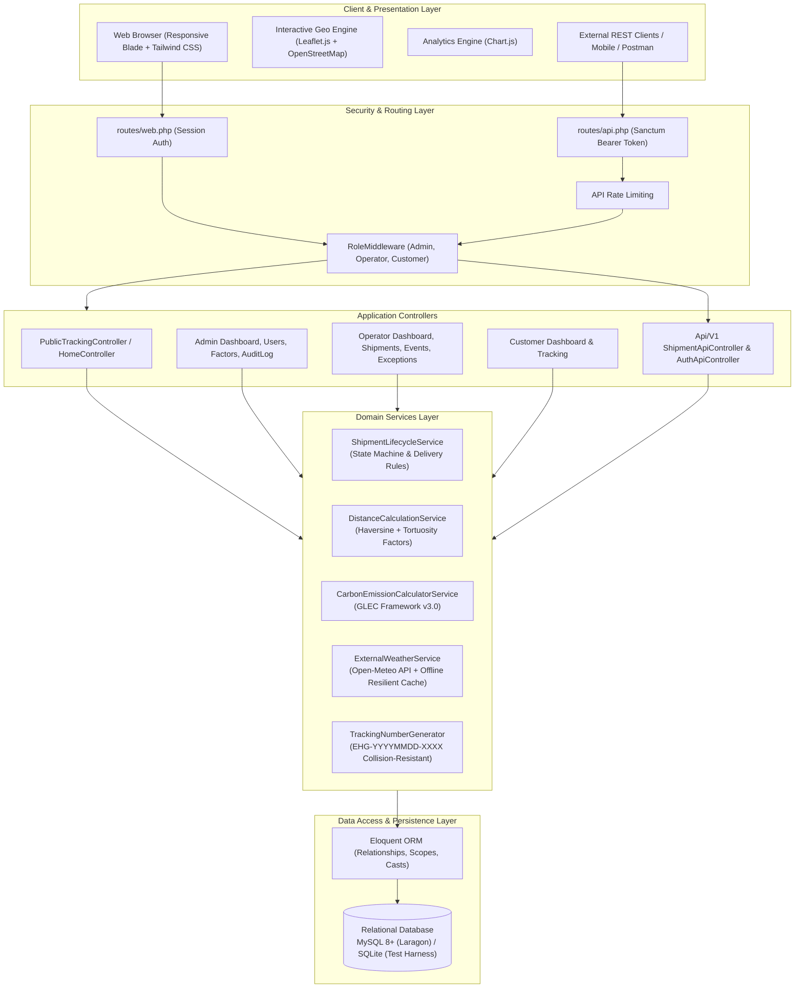
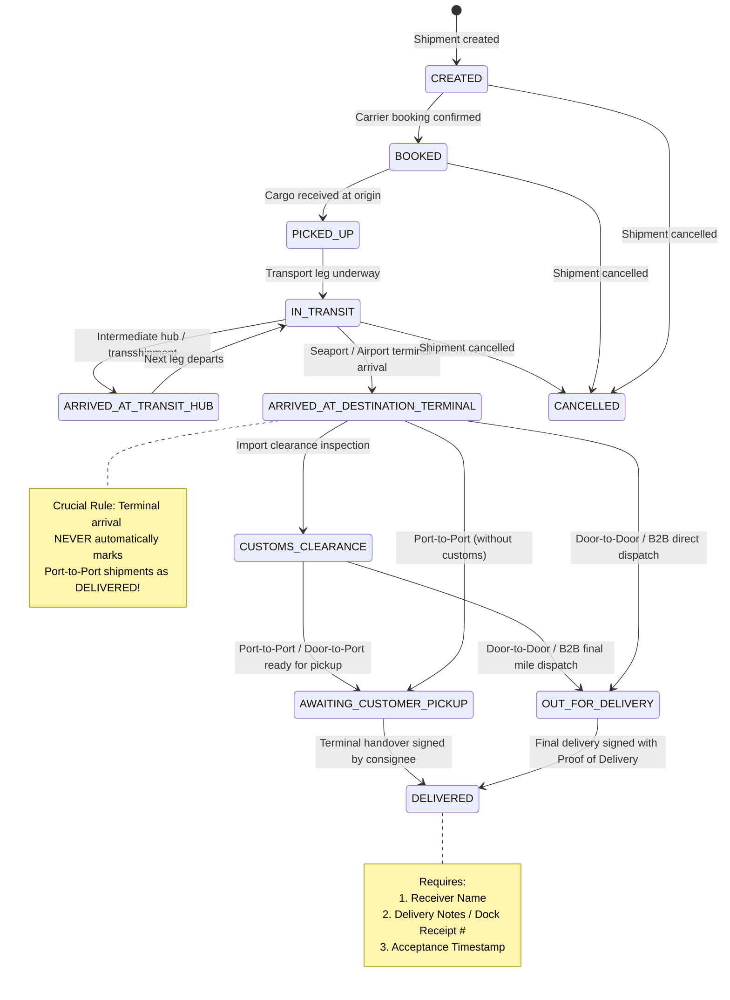

# EcoHorizon Global — System Architecture Document

This document details the software architecture, design patterns, lifecycle state machine, and scientific accounting methodologies underpinning the **EcoHorizon Global — Global Multimodal Freight Visibility Platform**.

---

## 1. High-Level Architecture Overview

EcoHorizon Global is engineered as a modern, maintainable Laravel 11 enterprise monolith with clean separation of concerns, robust domain services, server-side role-based authorization, and hybrid REST API endpoints.



---

## 2. Multimodal Freight Lifecycle State Machine

The core differentiation of EcoHorizon Global from standard domestic courier software is its strict separation between **physical multimodal transit**, **terminal/port arrivals**, and **final consignee delivery confirmation**.

### State Transition Diagram



### State Machine Transition Rules (`ShipmentLifecycleService`)

| From Status | Permitted Target Statuses | Validation Requirements |
| :--- | :--- | :--- |
| `CREATED` | `BOOKED`, `CANCELLED` | Valid origin and destination locations defined. |
| `BOOKED` | `PICKED_UP`, `IN_TRANSIT`, `CANCELLED` | Transport carrier assigned. |
| `PICKED_UP` | `IN_TRANSIT`, `ARRIVED_AT_TRANSIT_HUB`, `CANCELLED` | Cargo collected from shipper address. |
| `IN_TRANSIT` | `ARRIVED_AT_TRANSIT_HUB`, `ARRIVED_AT_DESTINATION_TERMINAL`, `CUSTOMS_CLEARANCE`, `OUT_FOR_DELIVERY`, `DELIVERED`, `CANCELLED` | Transport leg sequence update recorded. |
| `ARRIVED_AT_TRANSIT_HUB` | `IN_TRANSIT`, `CUSTOMS_CLEARANCE`, `CANCELLED` | Transshipment handling event logged. |
| `ARRIVED_AT_DESTINATION_TERMINAL` | `CUSTOMS_CLEARANCE`, `AWAITING_CUSTOMER_PICKUP`, `OUT_FOR_DELIVERY`, `DELIVERED` | For `PORT_TO_PORT` and `DOOR_TO_PORT`, must progress to `AWAITING_CUSTOMER_PICKUP` or `CUSTOMS_CLEARANCE`, **not direct to `DELIVERED`**. |
| `CUSTOMS_CLEARANCE` | `AWAITING_CUSTOMER_PICKUP`, `OUT_FOR_DELIVERY`, `DELIVERED` | Import clearance documentation validated. |
| `AWAITING_CUSTOMER_PICKUP` | `DELIVERED` | Consignee terminal gate pass & bill of lading presented. |
| `OUT_FOR_DELIVERY` | `DELIVERED` | Final mile driver delivery with proof of delivery name. |
| `DELIVERED` | *Terminal State* | Requires `proof_of_delivery_receiver_name` and `proof_of_delivery_at`. |
| `CANCELLED` | *Terminal State* | Immutable once cancelled. |

---

## 3. GLEC Framework v3.0 Carbon Accounting Methodology

EcoHorizon Global adheres to the **Global Logistics Emissions Council (GLEC) Framework Version 3.0**, standardizing greenhouse gas (GHG) reporting for multimodal supply chains in accordance with **ISO 14083**.

### 3.1. Mathematical Formula

For each sequential transport leg $i \in \{1, 2, \dots, n\}$:

$$\text{Leg Emissions } (\text{kg CO}_2\text{e}) = \frac{\text{Cargo Weight } (\text{t}) \times \text{Distance } d_i (\text{km}) \times \text{Factor } f_i (\text{g CO}_2\text{e}/\text{t-km})}{1000}$$

Total shipment footprint:

$$\text{Total CO}_2\text{e } (\text{kg}) = \sum_{i=1}^{n} \text{Leg Emissions}_i$$

### 3.2. Distance Calculation & Tortuosity Multipliers

Great-circle distance between two geographic coordinates $(\phi_1, \lambda_1)$ and $(\phi_2, \lambda_2)$ is calculated via the Haversine formula:

$$d_{\text{haversine}} = 2 R \cdot \arcsin\left(\sqrt{\sin^2\left(\frac{\Delta \phi}{2}\right) + \cos(\phi_1)\cos(\phi_2)\sin^2\left(\frac{\Delta \lambda}{2}\right)}\right)$$

Where $R = 6,371\text{ km}$ (mean radius of Earth).

Because vessels, freight trains, and trucks cannot travel in straight lines across Earth's surface, EcoHorizon Global applies empirical **route tortuosity factors**:

| Transport Mode | Tortuosity Factor | Empirical Basis |
| :--- | :--- | :--- |
| **Sea Freight** | `1.35x` | Maritime navigation through shipping lanes, straits (Malacca, Suez, Panama), and coastal routes. |
| **Land Freight** | `1.25x` | Highway road curvature, terrain elevation bypasses, and intermodal corridors. |
| **Air Freight** | `1.05x` | Standard instrument flight paths and air traffic routing corridors. |

Operators retain the authorization to manually override distances with audited carrier manifest values when official Bill of Lading distances are available.

### 3.3. Baseline Emission Factors Seeded

| Mode | Subcategory Profile | Factor ($\text{g CO}_2\text{e}/\text{t-km}$) | Standard Reference |
| :--- | :--- | :--- | :--- |
| **Sea** | Container Vessel (8,000+ TEU) *(Default)* | `11.5000` | GLEC Framework v3.0 / IMO 4th GHG Study |
| **Sea** | Feeder Container Vessel (< 2,000 TEU) | `26.8000` | GLEC Framework v3.0 |
| **Sea** | Bulk Carrier (Capesize) | `5.2000` | IMO MEPC.308(73) |
| **Land** | Heavy Articulated Diesel Truck (> 32t) *(Default)* | `62.0000` | GLEC Framework v3.0 / DEFRA 2024 |
| **Land** | Medium Distribution Truck (7.5t - 16t) | `118.0000` | GLEC Framework v3.0 |
| **Land** | Electric Freight Truck (Grid Average EU) | `18.5000` | GLEC Framework v3.0 (WTW) |
| **Land** | Freight Train (Electric Grid EU/Asia) | `15.0000` | GLEC Framework v3.0 |
| **Land** | Freight Train (Diesel) | `28.0000` | GLEC Framework v3.0 |
| **Air** | Dedicated Cargo Aircraft (Long-haul B777F/B747F) *(Default)* | `560.0000` | GLEC Framework v3.0 / IATA |
| **Air** | Bellyhold Passenger Aircraft (Wide-body) | `420.0000` | GLEC Framework v3.0 |

---

## 4. Role-Based Access Control (RBAC) Architecture

Server-side authorization is enforced at both HTTP middleware and model policy levels.

```
Request ---> Authenticate (Session / Sanctum Bearer)
                 |
                 v
             RoleMiddleware: [admin | operator | customer]
                 |
        +--------+--------+
        |                 |
     Allowed           Denied (HTTP 403 Forbidden)
        |
        v
    Controller Action
        |
        +--> Customer Ownership Scope: 
             If user is customer, query strictly checks:
             where('customer_user_id', Auth::id())
```

### RBAC Permission Matrix

| Capability | Administrator | Logistics Operator | Customer | Public Guest |
| :--- | :---: | :---: | :---: | :---: |
| Public Tracking by Number | Yes | Yes | Yes | Yes |
| View System Dashboard & KPI Graphs | Yes | No | No | No |
| Manage System Users & Assign Roles | Yes | No | No | No |
| Configure GLEC Carbon Factors | Yes | No | No | No |
| Review Full System Audit Trail | Yes | No | No | No |
| Operator Cockpit & Status Queues | Yes | Yes | No | No |
| Create New Multimodal Consignments | Yes | Yes | No | No |
| Edit Shipment Details & Cargo Info | Yes | Yes | No | No |
| Add / Reorder Transport Legs | Yes | Yes | No | No |
| Record Milestones & Tracking Events | Yes | Yes | No | No |
| Log & Resolve Delivery Exceptions | Yes | Yes | No | No |
| Confirm Final Delivery / Terminal Handover | Yes | Yes | No | No |
| View Own Authorized Shipments Dashboard | Yes | Yes | Yes (Own Only) | No |
| View Detailed Emission Footprint | Yes | Yes | Yes (Own Only) | Restricted |
| Sanctum REST API Access | Yes | Yes | Yes (Scoped) | No |

---

## 5. External Service Integration & Offline Resilience

### 5.1. Open-Meteo Weather API Integration
The platform queries live weather conditions at origin, destination, and transit locations to provide context on weather disruptions.

- **Endpoint**: `https://api.open-meteo.com/v1/forecast`
- **Parameters**: `latitude`, `longitude`, `current=temperature_2m,relative_humidity_2m,weather_code,wind_speed_10m`
- **WMO Code Translation**: Automatically converts WMO codes (0 = Clear sky, 61 = Rain, 95 = Thunderstorm, etc.) into human-readable descriptions, icons, and severity tags.
- **Fail-Safe Offline Mode**: If the academic demonstration environment is disconnected from the internet or rate-limited, `ExternalWeatherService` gracefully falls back to deterministic, geographically plausible weather states without throwing unhandled exceptions or stalling the user interface.

### 5.2. OpenStreetMap & Leaflet.js
- Maps are rendered in the browser using Leaflet.js (`v1.9.4`) with free OpenStreetMap tiles (`https://{s}.tile.openstreetmap.org/{z}/{x}/{y}.png`).
- Polylines dynamically connect origin, transit hubs, and destination coordinates with color-coded modes (Cyan for Sea, Amber for Land, Sky Blue for Air).

---

## 6. Audit Logging & Compliance Architecture

Every sensitive business operation triggers an immutable `AuditLog` entry storing:
- `user_id`: Authenticated user who performed the operation (`NULL` for automated events).
- `action`: `CREATE`, `UPDATE`, `STATUS_CHANGE`, `LEG_UPDATE`, `EXCEPTION_LOGGED`, `EXCEPTION_RESOLVED`, `DELIVERY_CONFIRMED`, `API_ACCESS`.
- `auditable_type` & `auditable_id`: Polymorphic reference to modified entity.
- `old_values` & `new_values`: JSON attribute snapshots.
- `ip_address` & `user_agent`: Originating HTTP request metadata.
- `created_at`: Immutable timestamp.
